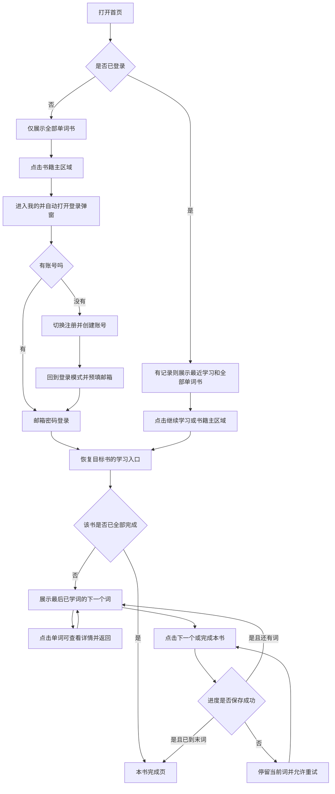

# H5 英语单词学习产品需求文档

版本：V1.0（MVP）

状态：需求初稿，可用于设计、开发与验收

说明：本文定义目标产品行为，不代表相关功能已在当前项目实现。线框图中的书名、词数和进度均为示意数据。

## 1. 产品目标与范围

面向使用手机浏览器学习英语单词的用户，提供「选择单词书 → 顺序学习 → 查看详情 → 保存进度 → 下次继续」的完整流程。

核心体验：无需登录即可浏览书库；登录后按书学习；学习卡片保持简单，详细内容放在单词详情页；进度绑定账号，退出登录后仍保留。

### 1.1 本期范围

| 模块 | 本期要求 |
| --- | --- |
| 主导航 | 底部固定两个 Tab：首页、我的 |
| 首页 | 全部单词书；已登录且有学习记录时展示最近学习 |
| 用户认证 | 在「我的」页面通过弹窗完成邮箱密码登录、注册 |
| 单词目录 | 查看一本书内的全部单词，支持分页或按需加载 |
| 单词学习 | 按固定顺序展示单词卡片，支持英美发音播放，点击下一步确认进度 |
| 单词详情 | 展示释义、例句、短语、真题、同近义词、同根词等已有数据，支持英美发音播放 |
| 我的 | 用户邮箱、退出登录、汇总学习进度、每本书学习进度 |
| 数据持久化 | 按用户和单词书保存学习位置，登录后可恢复 |

### 1.2 本期不包含

拼写测验、记忆算法、复习计划、收藏、生词本、打卡、排行榜、付费、第三方登录、找回密码、修改密码、运营后台、离线学习和重置进度。配图为后续增强项，不作为本期验收前置条件。

### 1.3 需求解释与默认决策

以下决策用于消除原始描述中的歧义，可在后续评审时调整：

1. 「所有单词书，展示所有单词」按两层组织：首页完整展示可用单词书；每本书提供「全部单词」入口，在目录中查看全部单词，避免首页展开整个词库。
2. 已登录用户点击书籍主区域直接进入学习；点击书籍旁的「全部单词」进入目录。两个入口应为独立点击区域，不嵌套链接。
3. 「最近学习」仅展示最近进入学习的 1 本书；不是最近浏览过的单词详情，也不是多本历史列表。
4. 「已学」指用户点击「下一个」或「完成本书」，且服务端保存成功的单词。仅打开卡片不算已学，因此未确认的当前词下次还会出现。
5. 单词顺序按词书导入顺序固定，学习入口从最后已学单词的下一个开始，不随机跳词。
6. 完成一本书后可通过目录查看任意单词详情，本期不自动循环学习、不清空进度。

## 2. 信息架构与用户流程

### 2.1 页面与建议路由

路由为实现建议；页面职责与访问规则为本期需求。

| 页面/状态 | 建议路由 | 访问权限 | 底部 Tab |
| --- | --- | --- | --- |
| 首页 | `/` | 所有人 | 显示，选中首页 |
| 我的 | `/me` | 所有人，按登录态展示不同内容 | 显示，选中我的 |
| 登录/注册弹窗 | `/me` 上的弹层 | 未登录用户 | 背景可见，弹窗打开时不可操作 |
| 单词目录 | `/books/[bookId]` | 已登录用户 | 隐藏 |
| 单词学习 | `/learn/[bookId]` | 已登录用户 | 隐藏 |
| 单词详情 | `/books/[bookId]/words/[wordId]` | 已登录用户 | 隐藏 |
| 本书完成 | `/learn/[bookId]/complete` | 已登录用户 | 隐藏 |

二级页面用顶部返回按钮导航，保留学习上下文。底部始终只定义首页、我的两个 Tab，不增加学习或书库 Tab。

### 2.2 主流程



点击「全部单词」的登录拦截流程相同，但登录成功后恢复目标目录。用户主动从「我的」登录且无待恢复目标时，成功后留在「我的」。

## 3. 通用 H5 交互与布局规范

- 以竖屏手机为主要场景，至少适配 320px、375px、390px、430px 视口；桌面端使用居中的受限宽度内容区，建议最大宽度 480px。
- 首页、我的底部导航固定，预留内容底部空间与 `safe-area-inset-bottom`，最后一条书籍和按钮不能被遮挡。
- 页面顶部适配安全区；二级页提供返回图标与页面标题。
- 学习页底部操作固定，内容较长时中间区域滚动；操作区高度稳定，不随按钮文案变化。
- 正文字号建议 14–16px，学习卡片单词建议 28–32px；固定字号按层级选择，不随视口宽度缩放。英文长词、例句和中文释义应自然换行，不横向溢出。
- 操作热区建议不小于 44×44px。底部导航使用图标加文字；返回、关闭等操作使用常见图标并提供可访问名称。
- 页面区块使用标题、间距和分隔线组织。单词学习可使用单一内容卡片，避免在卡片中嵌套卡片。
- 全站界面语言为中文，单词与例句保留原文。加载、空数据、失败必须有对应状态，不显示原始异常堆栈。
- 未确认登录态前展示中性加载态，避免闪现其他用户进度或错误的登录入口。

## 4. 页面功能与线框图

线框图中的 `[文字]` 表示操作入口，`<` 表示返回，`x` 表示关闭；实际实现使用相应图标。示意框仅表示区域边界，不要求每个区域都做成卡片。

### 4.1 首页：未登录

**展示内容**

- 页标题「首页」。
- 「全部单词书」完整书库，默认按配置顺序排列，不根据登录状态改变书库顺序。
- 书籍条目至少包含书名、有效单词总数；可选显示已有封面和简短描述，不依赖封面才能上线。
- 不展示「最近学习」及任何账号进度，不展示空的最近学习占位。
- 书库可以分页或按需加载，但最终应能访问全部已发布书籍；加载更多时不替换已加载内容。

**交互**

- 点击书籍主区域：记录目标书，跳转「我的」，自动打开登录弹窗。
- 点击「全部单词」：同样触发登录，保留目标目录。
- 点击底部「我的」：进入未登录的个人页，不自动弹窗。

```text
+--------------------------------------+
| 首页                                 |
|                                      |
| 全部单词书                           |
|                                      |
| 四级核心词汇                         |
| 共 1,000 词                          |
| [开始学习 >]            [全部单词 >] |
|--------------------------------------|
| 六级核心词汇                         |
| 共 1,200 词                          |
| [开始学习 >]            [全部单词 >] |
|--------------------------------------|
| ...更多单词书                        |
|                                      |
|                                      |
|--------------------------------------|
|       首页（选中）        我的        |
|             底部安全区               |
+--------------------------------------+
```

### 4.2 首页：已登录

**最近学习**

- 数据来源为当前用户最近一次成功进入学习的书，以服务端记录的 `lastStudiedAt` 排序取 1 本。
- 必须实际成功加载首张卡片后才创建该书学习记录；点击入口失败、仅查看目录或详情不创建记录。
- 展示书名、`已学数 / 总词数`、进度条和操作入口。
- 未完成时显示「继续学习」，直接进入该书下一个待确认单词。
- 已完成时显示「已完成」和「查看学习结果」，进入完成页，不自动从头开始。
- 无任何有效学习记录时整体隐藏该模块，「全部单词书」上移。

**全部单词书**

- 展示同一完整书库；最近学习的书仍可出现在书库中，不去重隐藏。
- 未开始的书显示「开始学习」；已开始显示「继续学习」及已学数；已完成显示「已完成」。
- 书籍主入口统一按该书进度进入学习或完成页；「全部单词」始终进入目录。

```text
+--------------------------------------+
| 首页                                 |
|                                      |
| 最近学习                             |
| 四级核心词汇                         |
| 已学 90 / 1,000                      |
| [===-----------------------------]   |
|                         [继续学习 >] |
|                                      |
| 全部单词书                           |
| 四级核心词汇                         |
| 已学 90 / 1,000                      |
| [继续学习 >]            [全部单词 >] |
|--------------------------------------|
| 六级核心词汇                         |
| 共 1,200 词                          |
| [开始学习 >]            [全部单词 >] |
|                                      |
|--------------------------------------|
|       首页（选中）        我的        |
+--------------------------------------+
```

### 4.3 我的：未登录

- 展示未登录状态和「登录 / 注册」主操作，不展示邮箱、退出按钮和虚构的学习统计。
- 手动进入该页时不强制弹窗；点击主操作打开登录模式。
- 从受限入口跳转到该页时自动打开弹窗。
- 关闭弹窗后留在「我的」；可以切换回首页继续浏览书库。

```text
+--------------------------------------+
| 我的                                 |
|                                      |
| 未登录                               |
|                                      |
|          [登录 / 注册]               |
|                                      |
|                                      |
|                                      |
|                                      |
|--------------------------------------|
|          首页          我的（选中）   |
+--------------------------------------+
```

### 4.4 登录 / 注册 Popup

采用移动端底部弹窗，遮罩覆盖全屏，背景页面禁止滚动和操作。小屏幕或键盘弹起时，弹窗内部可滚动，输入框、错误提示和提交按钮始终可达。

**登录模式**

- 标题「登录」，包含邮箱、密码、登录按钮以及「没有账号？注册」切换入口。
- 邮箱使用邮箱键盘和 `autocomplete=email`；密码使用密码输入框和 `autocomplete=current-password`。
- 点击提交后进入提交中状态，禁用重复提交；错误直接显示在对应字段或表单下方。
- 邮箱或密码错误统一提示「邮箱或密码不正确」；网络或服务异常提示「登录失败，请重试」。

**注册模式**

- 标题「注册」，只要求邮箱和密码，不增加用户名、手机号和确认密码。
- 密码使用 `autocomplete=new-password`。新密码至少 8 个字符，UTF-8 编码长度不超过 bcrypt 的 72 字节限制，不静默截断。
- 邮箱为必填、格式合法、去除首尾空格；当前数据库邮箱字段为 64 字符，本期按此上限校验。
- 服务端统一邮箱比较规则，并兼容已有账号，防止仅大小写不同的邮箱重复注册。
- 重复邮箱提示「该邮箱已注册，请登录」；注册失败保留邮箱并提供重试。
- 注册成功后在同一个弹窗中切回登录模式，预填邮箱、清空密码，提示「注册成功，请登录」；本期不自动登录。
- 登录模式只做必填等登录校验，不用新注册密码强度规则拦截已有账号。

**关闭与切换**

- 右上角关闭、点击遮罩、浏览器返回均可关闭弹窗；关闭不提交表单。
- 登录与注册模式切换时保留邮箱、清空密码、清除上一模式的错误。
- 提交中关闭后，请求可能仍完成；再次打开时从服务端确认登录状态，避免展示过期表单。
- 弹窗打开时焦点进入表单，关闭后恢复到触发入口；支持键盘访问，不让焦点落到被遮罩的内容。

**登录后恢复目标**

- 保留 `bookId` 与入口类型（学习/目录/详情），详情入口还需保留 `wordId`；使用会话级临时状态或包含完整目标信息的站内 `returnTo` 参数记录，不保存密码。
- 只允许恢复站内合法路径，服务端验证书和单词确实存在。
- 关闭弹窗时保留当前待恢复目标；离开「我的」、退出登录或登录成功后清除，新的受限入口可覆盖旧目标。
- 登录成功后关闭弹窗并恢复原目标；目标已失效时留在「我的」并提示「内容暂不可用」。
- 学习页会话过期后重新登录，按服务端已保存进度恢复，未保存的当前词不计完成。

```text
登录模式                               注册模式
+----------------------------------+   +----------------------------------+
| 我的（遮罩背景，不可操作）       |   | 我的（遮罩背景，不可操作）       |
|                                  |   |                                  |
|----------------------------------|   |----------------------------------|
| 登录                         [x] |   | 注册                         [x] |
|                                  |   |                                  |
| 邮箱                             |   | 邮箱                             |
| [name@example.com              ] |   | [name@example.com              ] |
| 密码                             |   | 密码                             |
| [****************              ] |   | [****************              ] |
| 邮箱或密码不正确                 |   | 该邮箱已注册，请登录             |
|                                  |   |                                  |
| [             登录             ] |   | [             注册             ] |
| 没有账号？[注册]                 |   | 已有账号？[登录]                 |
|             安全区               |   |             安全区               |
+----------------------------------+   +----------------------------------+
```

图中的错误仅在对应失败状态出现，不在初始状态常驻。

### 4.5 我的：已登录

**账号信息**

- 展示当前登录邮箱；较长邮箱允许换行，不能挤压退出操作。
- 提供「退出登录」按钮，点击后调用现有退出逻辑，成功后留在「我的」未登录态。
- 退出后立即清理该用户在客户端的进度缓存和待恢复目标，保留服务端学习数据；失败时保持登录态并提示重试。

**学习进度**

| 统计项 | 定义 |
| --- | --- |
| 累计已学 | 当前用户在有效已发布书籍中已确认完成条目数之和；同一个词在两本书中出现时分别计数，不代表去重后的词汇量或掌握量 |
| 学习中 | 已成功进入学习、但尚未完成的有效书籍数；首次打开的 `0/N` 也计入 |
| 已完成 | 已确认全部有效单词的书籍数 |
| 每书进度 | 书名、已学数/总词数、百分比、最近学习时间和继续/查看结果入口 |

- 每书进度按 `lastStudiedAt` 倒序展示，包含已完成的书。
- 无学习记录时，汇总显示 0，列表显示「暂无学习记录」和「去选书」入口。
- 点击「去选书」切回首页；点击未完成书进入学习，点击已完成书进入完成页。

```text
+--------------------------------------+
| 我的                                 |
|                                      |
| learner@example.com                  |
|                           [退出登录] |
|--------------------------------------|
| 学习进度                             |
| 累计已学       学习中       已完成   |
|   90             1             0     |
|                                      |
| 四级核心词汇                         |
| 已学 90 / 1,000                 9%   |
| [===-----------------------------]   |
| 最近学习：今天 20:30                 |
|                         [继续学习 >] |
|--------------------------------------|
| ...其他已开始学习的书                |
|                                      |
|--------------------------------------|
|          首页          我的（选中）   |
+--------------------------------------+
```

最近学习时间由服务端存储统一时间，在客户端按用户本地时区展示。

### 4.6 单词目录页

用于满足「展示所有单词」和完成后的查阅需求，不增加第三个 Tab。

- 顶部展示书名、总词数、已学数和开始/继续学习入口。
- 按书内固定顺序展示所有有效单词；每条包含序号、单词、第一条有效中文释义和已学状态。
- 长列表分页或按需加载，例如每批 50 条；保留已加载内容和滚动位置，不一次加载所有单词详情数据。
- 点击单词进入详情，返回时恢复目录位置。
- 浏览目录和详情均不推进学习进度；点击目录内较后的词也不跳过前面的待学词。
- 顶部开始/继续按钮始终遵循服务端游标，不从当前目录滚动位置开始。
- 已完成时顶部显示「已完成」，仍可浏览所有词；空书显示空态并禁用学习入口。
- 该页本期不要求搜索、筛选、排序和任意选词作为学习起点。

```text
+--------------------------------------+
| [<] 四级核心词汇                     |
|                                      |
| 已学 90 / 1,000                      |
| [             继续学习             ] |
|--------------------------------------|
| 全部单词                             |
|  89  example    n. 例子         已学 |
|  90  ...                        已学 |
|  91  fetch      v. 取回          [>] |
|  92  ...                         [>] |
|                                      |
| ...按需加载                          |
|                                      |
+--------------------------------------+
```

### 4.7 单词学习页

**进入规则**

- 首次学习从第 1 个有效单词开始。
- 已有进度时，从最近已确认单词的下一个开始；例如已学到第 90 个，则进入第 91 个。
- 顶部展示书名、`当前词序号 / 总词数` 和 `已学数`。序号与已学数是不同指标，不能将正在看的词提前计入已学。
- 返回按钮优先回到本次来源（首页、我的或目录）；没有站内来源时回首页。

**最简单词卡片**

1. 单词，作为进入详情的明确点击入口。
2. 一个音标，默认优先英式 `ukphone`，缺失时依次使用 `usphone`、`phone`；另提供英音、美音两个播放入口。
3. 第一条有效释义的词性和中文释义。
4. 第一条有效普通例句，仅 1 组英文与中文，不在卡片上轮播多条。
5. 底部「下一个」按钮；最后一个词改为「完成本书」。

卡片不展示全部释义、英释、图片、真题、短语和同根词。不增加翻面、熟悉度评分或上一个按钮。卡片使用完整换行的内容，不为了固定高度截断核心释义和例句；操作按钮固定在安全区上方。

**交互规则**

- 点击单词进入该词详情，返回时仍是原卡片；查看详情不确认该词。
- 点击英音或美音播放对应发音，不确认单词、不更新学习进度；播放规则见第 6.5 节。
- 点击「下一个」：保存当前词为已学，保存成功后切到下一个；失败不切词、不增加数量。
- 保存期间按钮禁用，展示「保存中…」，防止连续点击跳过单词。
- 中途返回或关闭页面时不隐式确认当前词，不依赖卸载事件补写进度。
- 本书所有词确认完成后进入完成页；只有最后一次保存成功才展示完成结果。

```text
+--------------------------------------+
| [<] 四级核心词汇          [目录图标] |
| 当前 91 / 1,000          已学 90 词  |
|                                      |
| +----------------------------------+ |
| |                                  | |
| |             [fetch >]            | |
| |               /fetʃ/             | |
| |                                  | |
| |              v. 取回             | |
| |                                  | |
| | Sylvia fetched a towel from      | |
| | the bathroom.                    | |
| | 西尔维娅从浴室拿来一条毛巾。     | |
| |                                  | |
| +----------------------------------+ |
|                                      |
| [              下一个              ] |
|               安全区                 |
+--------------------------------------+
```

### 4.8 单词详情页

- 顶部返回到来源卡片或目录，保留其状态；独立打开详情时，默认返回所属书的目录。
- 首屏展示单词、可用音标、英音/美音播放入口和全部释义。其他内容按数据存在与否依次展示。
- 内容较长时页面滚动；不将每个小模块做成相互嵌套的卡片。
- 不提供「下一个」学习按钮，避免浏览详情时改变进度。
- 详情模块顺序：词头与音标 → 中英文释义 → 普通例句 → 短语 → 真题例句 → 同近义词 → 同根词。
- 无内容的模块整体隐藏，来源信息不完整时只展示实际存在的字段，不显示 `undefined`、空标题或空分隔区。

```text
+--------------------------------------+
| [<] 单词详情                         |
|                                      |
| fetch                                |
| 英 /fetʃ/       美 /fɛtʃ/             |
|                                      |
| 释义                                 |
| v. 取回                              |
| If you fetch something or someone,   |
| you go and get them from ...          |
|--------------------------------------|
| 例句                                 |
| Sylvia fetched a towel from the      |
| bathroom.                            |
| 西尔维娅从浴室拿来一条毛巾。         |
|                                      |
| Fetch me a glass of water.            |
| 给我拿杯水来。                       |
|--------------------------------------|
| 短语                                 |
| fetch in    引进，招来               |
| fetch up    引起；到达；最终成为     |
| ...                                  |
|--------------------------------------|
| 真题例句                             |
| ...All computers do is fetch...      |
| CET4 / 2012.12 / 第一套 / 阅读理解   |
|--------------------------------------|
| 同近义词                             |
| vt. 取来；接来；到达；吸引           |
| absorb / attract / engage / ...       |
|--------------------------------------|
| 同根词                               |
| adj. fetching  迷人的；动人的        |
+--------------------------------------+
```

图中省略号只缩短线框图；真实详情应渲染全部有效文本和条目。

### 4.9 本书完成页

- 展示书名、「本书已学完」、`N / N` 和 100% 进度。
- 每次进入都核验当前用户的服务端进度；未学完时直接访问完成页，应转回下一个待学词，空书或失效书按对应状态处理，不展示虚假的完成结果。
- 提供「查看全部单词」「返回首页」；顶部返回至来源页，没有来源时回首页，避免返回末词重复提交。
- 已完成的书再次从首页、我的或最近学习进入时，直接到此页。
- 本期不自动生成测验、不自动重置进度、不将已学等同于已掌握。

```text
+--------------------------------------+
| [<] 学习结果                         |
|                                      |
|             本书已学完               |
|                                      |
|             四级核心词汇             |
|           1,000 / 1,000               |
|                100%                  |
|                                      |
| [           查看全部单词           ] |
| [             返回首页             ] |
|                                      |
+--------------------------------------+
```

## 5. 学习进度业务规则

### 5.1 游标定义

每本书的有效单词按固定顺序排列，内部使用从 0 开始的索引；界面序号从 1 开始。

| 字段/概念 | 定义 |
| --- | --- |
| `totalWords` | 当前发布版本中有效单词数量，不包括被过滤的非法条目 |
| `lastCompletedIndex` | 最近已确认完成词的索引；未确认过任何词时为 `null` |
| `lastCompletedWordId` | 最近已确认完成词的稳定 ID；未确认时为 `null` |
| `learnedCount` | 初始为 0，否则为 `lastCompletedIndex + 1` |
| `nextIndex` | 初始为 0，否则为 `lastCompletedIndex + 1` |
| `progressPercent` | `totalWords > 0` 时为 `learnedCount / totalWords × 100%`；空书不计算完成 |
| `isCompleted` | `totalWords > 0` 且 `learnedCount === totalWords` |

进度条使用真实比例；文字百分比可保留 1 位小数，未完成时不得因四舍五入显示 100%。已学数/总数始终为准确整数。

### 5.2 状态示例

假设某书共有 100 个词：

| 用户操作 | 已保存进度 | 下次学习入口 |
| --- | --- | --- |
| 从未打开学习页 | 无记录，已学 0 | 第 1 个词 |
| 首次成功打开第 1 个词，但未点下一步 | 有学习记录，已学 0 | 第 1 个词 |
| 第 1 个词点击下一步且保存成功 | 已学 1 | 第 2 个词 |
| 正在看第 91 个词，已确认前 90 个 | 已学 90 | 第 91 个词 |
| 从第 91 个词进入详情后退出 | 已学 90 | 第 91 个词 |
| 第 91 个词保存失败 | 已学 90 | 第 91 个词 |
| 第 100 个词点击完成且保存成功 | 已学 100，已完成 | 完成页 |
| 通过目录查看第 100 个词详情 | 既有进度不变 | 仍从原待学词继续 |

### 5.3 持久化与一致性

- 以服务端记录为准，按 `userId + bookId` 隔离；同一本书在不同账号下分别保存。
- 每次确认完成当前词时立即持久化，不等到离开页面或退出登录才保存。
- `lastStudiedAt` 在成功加载学习卡片、成功确认学习时更新；只查看目录/详情不更新。
- 保存操作必须幂等，重复提交同一词不能重复计数、不能跳过下一词。
- 服务端只接受按顺序确认当前待学词，不允许客户端任意传入已学数量、百分比或其他用户 ID。
- 多个窗口同时学习时使用版本号或等效条件更新；过期请求不能覆盖新进度。遇到冲突重新拉取进度，提示「学习进度已更新」，按最新游标恢复。
- 保存成功后同步首页最近学习、书籍进度和我的统计；返回这些页面不应继续展示旧值。
- 保存失败时留在当前卡片，显示「进度保存失败，请重试」，允许再次点击；服务端已保存但响应丢失时，重试应返回一致结果。
- 会话失效时停止保存，进入「我的」登录弹窗流程；重新登录后按服务端游标恢复。
- 本期已发布书的内容和顺序固定，以 `bookVersion` 绑定。内容升级需提供显式迁移，不能用新数组下标静默解释旧进度。
- 书籍下架后保留历史数据，不计入当前有效书籍汇总，不提供学习跳转；不能把失效书误认为一本空书并标记完成。

## 6. 单词数据与渲染规则

### 6.1 数据结构约定

用户提供的是单条单词对象，根字段为 `word`。单词书元数据与单词集合尚未提供，需要独立组织。下面字段路径均按该根结构描述。

| 实体 | 最小字段 | 说明 |
| --- | --- | --- |
| 单词书 | `bookId`、`title`、`bookVersion`、`sortOrder`、`totalWords`、`status` | `description`、`coverUrl` 可选；`status` 区分已发布与下架 |
| 书内单词 | `bookId`、`wordId`、`orderIndex`、完整 `word` 数据 | 唯一键为 `bookId + wordId`；`orderIndex` 在书内唯一 |
| 学习进度 | `userId`、`bookId`、`bookVersion`、`lastCompletedWordId`、`lastCompletedIndex`、`startedAt`、`lastStudiedAt`、`completedAt`、`revision` | 用户与书唯一；`revision` 用于并发控制，统计值由游标推导 |

导入时过滤缺少有效 `wordHead` 或 `wordId` 的记录，检查重复 ID，确保书内顺序唯一；不要简单按 `wordId` 字符串排序。过滤后的有效顺序与 `totalWords` 必须一致。

### 6.2 字段映射

下表中的 `content` 均指 `word.content`。

| 数据字段 | 卡片 | 详情 | 渲染规则 |
| --- | --- | --- | --- |
| `word.wordHead` | 是 | 是 | 单词主体；卡片上可点击进入详情 |
| `word.wordId` | 不显示 | 不显示 | 用于定位、路由与进度，不作为界面文案 |
| `content.ukphone` | 优先 | 是 | 英式音标；展示时加 `/ /`，不要重复已有斜线 |
| `content.usphone` | 回退 | 是 | 美式音标；详情标记「美」 |
| `content.phone` | 最后回退 | 按需 | 英美均缺失时显示通用音标，不重复展示相同来源 |
| `content.trans[].pos` | 首条 | 全部 | 与该条释义一起展示，展示时规范词性标点 |
| `content.trans[].tranCn` | 首条有效中释 | 全部 | 优先取第一条有非空中释的记录，不拼接所有释义到卡片 |
| `content.trans[].tranOther` | 否 | 是 | 非空时展示对应英释 |
| `content.sentence.sentences[].sContent` | 首条有效英文例句 | 全部 | 卡片只有 1 条，缺失时不以真题替代 |
| `content.sentence.sentences[].sCn` | 对应中文 | 全部 | 与同一条英文配对；中文缺失则仅显示英文 |
| `content.phrase.phrases[].pContent / pCn` | 否 | 全部 | 按原顺序展示短语及中文 |
| `content.realExamSentence.sentences[].sContent` | 否 | 全部 | 展示真题例句，保留原始省略号 |
| `content.realExamSentence.sentences[].sourceInfo` | 否 | 是 | 将 `level`、`year`、`paper`、`type` 中非空字段组合为来源 |
| `content.syno.synos[].pos / tran / hwds[].w` | 否 | 全部 | 按词性分组展示同近义词；不要求跨词跳转 |
| `content.relWord.rels[].pos / words[].hwd / tran` | 否 | 全部 | 按词性展示同根词及对应释义 |
| `content.picture` | 否 | 后续增强 | 本期不必展示；后续需验证 HTTPS 可用性和失败降级 |
| `content.ukspeech / usspeech / speech` | 不直接使用 | 不直接使用 | 发音统一由词头构造有道播放 URL，不将这些参数当作完整音频地址 |
| `content.star` | 否 | 否 | 来源业务语义未明确，不作为用户收藏、星级或学习进度 |
| 各模块 `desc`、`descCn`、`descOther` | 否 | 不直接依赖 | 模块标题采用统一中文，不让来源描述决定页面结构 |

### 6.3 示例 `fetch` 的最简卡片

```text
fetch
/fetʃ/
[英音] [美音]
v. 取回

Sylvia fetched a towel from the bathroom.
西尔维娅从浴室拿来一条毛巾。

[下一个]
```

仅显示第一个例句；第二个例句、英释、5 个短语、真题、同近义词和同根词在详情中完整展示。

### 6.4 缺失字段与异常数据

- `content` 及内部字段可能缺失，渲染时按可选数据处理，不假定所有数组都有元素。
- 无音标：隐藏音标行。无中释但有英释：回退展示首条有效英释。中英释义都没有：显示「暂无释义」。
- 无有效英文例句：隐藏卡片例句区域，不伪造示例；详情仍展示其他可用模块。
- 数组中的空项过滤后再决定是否展示模块，保留有效内容的原顺序。
- 单词、释义、例句、来源等按纯文本安全渲染，不执行来自词库的 HTML。
- 词书或单词不存在时展示对应失效页和返回入口，不通过数组越界显示空白。

### 6.5 发音播放

- 学习卡片和单词详情均提供英音、美音播放按钮。即使缺少音标，也可根据有效词头播放发音。
- 使用 `https://dict.youdao.com/dictvoice?audio={word}&type={1|2}`，`audio` 取当前单词的 `headWord`（归一化自 `word.wordHead` 等来源）并进行 URL 查询参数编码；`type=1` 为英音，`type=2` 为美音。
- 由客户端直接播放有道音频，只在用户点击后播放；切换单词或离开页面时停止，切换口音时停止上一段音频。加载中、播放中和失败应有可辨识状态，失败可重试。
- 播放不调用学习访问登记或确认接口，不修改已学数、学习游标或最近学习时间。

## 7. 现有项目认证逻辑的复用与适配

### 7.1 已有能力

| 文件 | 当前行为 | 本期用途 |
| --- | --- | --- |
| `app/login/page.tsx` | 调用 `signIn('credentials', ...)`，成功跳转 `/protected` | 复用邮箱密码登录机制，改为支持弹窗错误反馈及站内目标恢复 |
| `app/register/page.tsx` | 调用 `getUser` 检查账号，`createUser` 注册，成功跳转 `/login` | 复用账号查询与创建，成功后在弹窗内切回登录 |
| `app/form.tsx` | 提供邮箱和密码必填表单 | 参考字段与自动填充；增加登录/注册模式、错误、提交中状态 |
| `app/auth.ts` | NextAuth Credentials 与 bcrypt 密码校验，导出 `auth/signIn/signOut` | 继续作为认证入口，不另建一套账号体系 |
| `app/db.ts` | PostgreSQL/Drizzle 用户读写，bcrypt 哈希存储 | 复用用户数据；补足邮箱唯一约束和服务端输入校验 |
| `app/protected/page.tsx` | 展示 session 邮箱并调用 `signOut` | 参考账号信息展示及退出逻辑 |
| `app/auth.config.ts`、`middleware.ts` | 当前对已登录用户的其他页面请求统一跳到 `/protected` | 调整鉴权与重定向，允许访问新首页、我的和学习页面 |

### 7.2 必须补齐的行为

- 保持邮箱密码认证与现有账号兼容，不直接把现有登录、注册整页嵌入弹窗。
- 当前注册的重复邮箱返回值尚无可见表单反馈，需要转成可呈现的错误状态。
- 将固定 `/protected` 和 `/login` 的成功跳转适配为弹窗状态与目标恢复，不能导致已登录用户无法访问首页。
- `/`、`/me` 对访客公开；学习、目录、详情、完成页和进度接口需校验 session。
- 访客直接打开受限链接时也转到「我的」并弹出登录，不出现可操作的学习页。
- 用户身份从服务端 session 获取，进度查询与保存都必须按当前用户过滤，不能依赖客户端传入邮箱或用户 ID。
- 若当前 session 未携带稳定用户 ID，实现时需补充或在服务端映射到现有用户主键。
- 密码只交给认证服务并以哈希存储，不写入 URL、前端持久化缓存或日志。
- 注册唯一性需要数据库约束保障，不能只依赖先查询后插入；已有重复账号应在加约束前处理。
- 原 `/login`、`/register` 可保留为兼容入口并导向「我的」的对应弹窗模式；`/protected` 可兼容导向「我的」。

## 8. 数据交互职责

可使用 Next.js Server Actions 或接口实现，不要求为了本文额外引入 REST。以下为所需能力边界。

| 能力 | 请求信息 | 返回/副作用 |
| --- | --- | --- |
| 公开书库 | 分页信息 | 已发布书的元数据，不携带任何用户进度 |
| 当前用户进度 | 服务端 session | 最近学习、各书游标与汇总统计 |
| 单词目录 | session、`bookId`、分页信息 | 固定顺序的词头、简释、序号及总量 |
| 学习入口 | session、`bookId` | 校验书版本，返回下一待学词或已完成状态；成功展示后记录学习访问 |
| 单词详情 | session、`bookId`、`wordId` | 返回所属书内该词完整内容，不更新学习游标 |
| 确认当前词完成 | session、`bookId`、`bookVersion`、`wordId`、预期进度版本 | 幂等更新，返回最新进度及下一词/完成状态 |

首页最近学习和我的汇总必须使用相同统计口径。书库元数据可以缓存；账号进度缓存必须按用户隔离，登录、退出和进度写入后及时失效。

## 9. 加载、空态与失败状态

| 场景 | 界面行为 | 恢复方式 |
| --- | --- | --- |
| 书库首次加载 | 展示稳定高度的占位，不显示虚构书籍 | 加载完成后替换 |
| 书库为空 | 「暂无单词书」 | 不展示空学习按钮 |
| 书库请求失败 | 「单词书加载失败」 | 重试按钮 |
| 最近学习/进度请求失败 | 书库继续可用，进度区域显示失败状态，不冒充无记录 | 单独重试 |
| 已登录但无学习记录 | 首页隐藏最近学习；我的显示零统计和空态 | 去选书 |
| 学习页加载中 | 显示占位，下一步不可用 | 成功后展示卡片 |
| 当前词加载失败 | 不确认当前词，不切换游标 | 重试或返回 |
| 进度保存失败 | 保留当前卡片与已保存数量 | 再次点击保存 |
| 会话过期 | 停止受限操作，进入我的登录弹窗 | 登录后恢复目标 |
| 书为空 | 「本书暂无单词」，禁用学习入口 | 返回书库 |
| 书/词失效 | 「内容暂不可用」 | 返回首页或有效目录 |
| 登录/注册失败 | 弹窗保持打开，保留邮箱，显示字段或表单错误 | 修改后重试 |

页面级失败态可沿用下列布局，提示文案按场景替换：

```text
+--------------------------------------+
| [<] 单词学习                         |
|                                      |
|                                      |
|          单词加载失败                 |
|                                      |
|              [重试]                  |
|              [返回]                  |
|                                      |
+--------------------------------------+
```

## 10. 非功能要求

- **性能**：首页优先加载书籍元数据；目录只加载列表字段；学习页每次渲染一个词，不把整本完整 JSON 作为首屏依赖。可预取下一词，但预取不创建已学记录。
- **正确性**：任何已学数量都来源于服务端已确认进度；网络重试、刷新、浏览器返回不得重复计数或跳词。
- **可用性**：常用移动浏览器及 iOS Safari、Android Chrome 中底部按钮和弹窗输入不被浏览器栏、刘海安全区、软键盘遮挡。
- **可访问性**：表单关联 label，错误可被读屏识别；弹窗焦点受控；图标按钮具备名称；进度同时有文本，不能只依赖颜色。
- **数据安全**：服务端校验权限与参数；不同账号不能互读进度；认证与数据请求通过 HTTPS；数据库和认证配置沿用项目环境变量。
- **交付数据**：开发联调可以使用明确标记的示例数据；正式上线前需要提供真实词书元数据、完整单词集合及固定导入顺序，仅 `fetch` 示例不足以构成整本书。

## 11. 验收标准

| 编号 | 操作/前置条件 | 预期结果 |
| --- | --- | --- |
| AC-01 | 手机打开首页 | 底部只有首页、我的两个 Tab，选中态正确，内容不被底栏遮挡 |
| AC-02 | 访客打开首页 | 只展示书库，不显示最近学习或用户进度 |
| AC-03 | 访客点击某书的开始学习 | 跳转我的并自动打开登录弹窗，保留目标书 |
| AC-04 | 访客主动切到我的 | 展示未登录状态，不强制弹窗；点击登录入口后弹窗出现 |
| AC-05 | 弹窗切换注册并成功提交 | 切回登录模式，预填邮箱并清空密码；未自动获得登录态 |
| AC-06 | 使用已注册邮箱再次注册，或输入错误密码登录 | 显示对应错误，页面不空白，邮箱保留，可再次提交 |
| AC-07 | 从书籍学习入口完成登录 | 自动进入目标书第一个或下一个待学词；目标书已完成时进入完成页 |
| AC-08 | 从全部单词入口完成登录 | 自动进入目标书目录，不直接进入学习 |
| AC-09 | 已登录但从未学习 | 首页无最近学习；我的统计为 0，并提供去选书入口 |
| AC-10 | 成功打开一本书的第一张卡片但未点击下一步 | 建立 `0/N` 学习记录，成为最近学习；下次仍展示第 1 个词 |
| AC-11 | 已确认到第 90 个词后重新进入 | 展示第 91 个词，已学数为 90，不跳到第 92 个 |
| AC-12 | 当前词点击下一步并保存成功 | 已学数只加 1，切换到下一个；首页与我的同步更新 |
| AC-13 | 连续快速点击或重复提交同一次确认 | 不重复计数，不跳词；提交中按钮不可重复操作 |
| AC-14 | 保存失败或响应丢失后重试 | 失败时留在当前词；重试结果与服务端已保存状态一致 |
| AC-15 | 当前卡片点击单词进入详情后返回 | 原卡片仍在，游标与已学数不变 |
| AC-16 | 通过目录浏览任意后续词详情 | 不创建学习进度，不跳过原待学词 |
| AC-17 | 使用示例 `fetch` 渲染 | 卡片显示词头、一个音标、英美音播放入口、首条释义、1 组例句；详情显示全部有效模块 |
| AC-18 | 词数据缺少音标、例句或扩展模块 | 隐藏相应区域或按约定回退，无空标题、`undefined` 或渲染错误 |
| AC-19 | 在最后一个词点击完成并保存成功 | 显示 `N/N`、100% 和本书已学完，后续进入不自动清空进度 |
| AC-20 | 同一账号刷新页面或换设备登录 | 从服务端已保存游标继续；未确认的当前词再次展示 |
| AC-21 | 两个窗口同时确认学习或账号会话过期 | 旧请求不覆盖新进度；过期会话进入登录流程，不写入错误账号 |
| AC-22 | 退出账号 A，再登录账号 B | B 看不到 A 的邮箱、最近学习或统计；A 再登录仍可恢复原进度 |
| AC-23 | 登录用户访问首页、我的、目录及学习页 | 不再被现有全局规则强制跳转到 `/protected` |
| AC-24 | 书库/进度失败、空书、内容失效 | 展示第 9 节对应状态与恢复入口，不误显示为已完成 |
| AC-25 | 320px 至 430px 手机宽度，弹出键盘、长邮箱、长词、长例句 | 无横向溢出、文字重叠和不可点击按钮，弹窗提交操作可达 |
| AC-26 | 未完成时直接访问完成页，或从单词详情触发登录 | 前者回到服务端待学词；后者登录成功后恢复原 `bookId + wordId` 的详情，不改变进度 |
| AC-27 | 在学习卡片或详情页点击英音、美音播放 | 根据当前词头请求有道音频，分别使用 `type=1`、`type=2`；播放不更新任何学习进度 |

验收以真实账号和至少一本包含多个词的固定顺序测试书执行；另准备空书、缺字段词、末词进度、失效书等数据覆盖边界情况。
