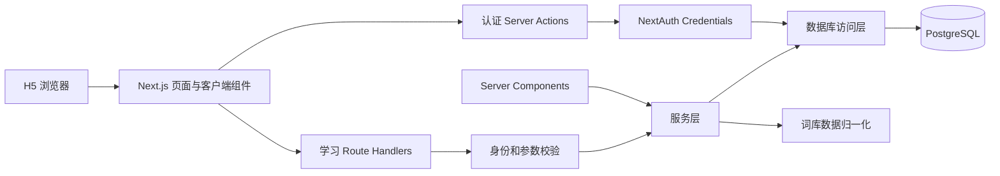
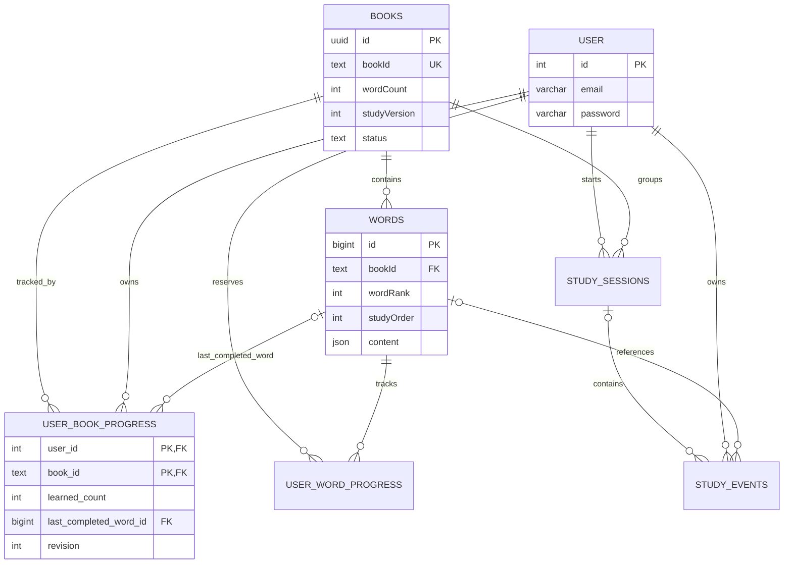
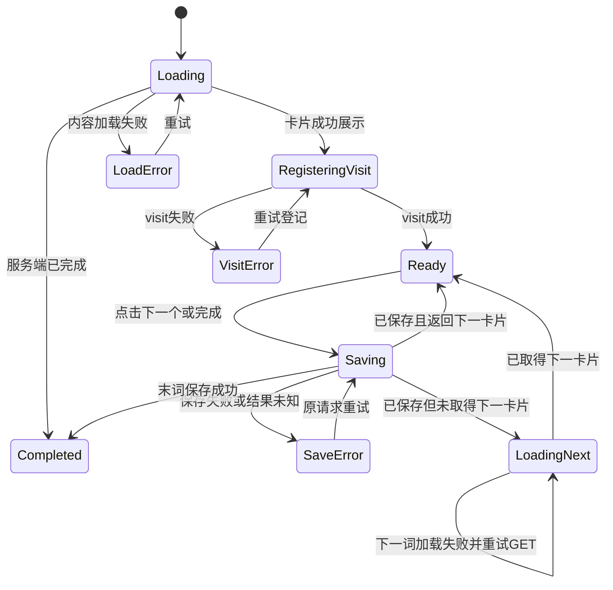

# H5 英语单词学习项目技术设计文档

版本：V1.0（MVP）

需求依据：[产品需求文档](./prd.md)

文档性质：前后端技术方案。现有 `books`、`words` 基线以提供的 DDL 为准；数据库 schema、版本化 SQL、迁移命令和隔离测试已落地，操作方式见[数据库迁移说明](./database.md)。前端页面、NextAuth 邮箱认证、真实词库接口与学习进度事务已实现，运行与验证边界见[前端说明](./frontend.md)。具体环境的迁移状态以版本记录为准。

## 1. 目标与技术决策

本期实现书库浏览、邮箱密码认证、顺序背词、词义详情、断点续学和个人学习统计。方案沿用项目现有技术栈，不另外拆分独立后端。

| 项目 | 选型与约定 |
| --- | --- |
| Web 框架 | Next.js 14 App Router，保留当前主版本 |
| UI | React 18、TypeScript、Tailwind CSS，移动端优先 |
| 认证 | NextAuth Credentials，JWT session，复用邮箱密码及 bcrypt |
| 数据访问 | PostgreSQL、Drizzle ORM、postgres.js，仅服务端访问 |
| 页面初始数据 | Server Components 直接调用服务层 |
| 客户端交互 | 登录弹窗、卡片切换、目录加载更多使用 Client Components |
| 数据读写 | 认证使用 Server Actions；词书与学习交互使用 Route Handlers；复用相同服务层 |
| 校验 | 建议新增 Zod 进行服务端运行时校验，前端可复用非敏感规则 |
| 图标 | 建议新增 `lucide-react`，用于返回、关闭、目录和底部导航 |
| 状态管理 | MVP 使用组件状态与 `router.refresh()`，不引入全局状态管理库 |

图标依赖、前端页面、真实认证、词库接口与学习进度事务已实现。输入通过 `lib/validation` 的显式校验函数验证，未引入 Zod；目录和公开书库使用键集分页。当前个人进度返回全部有效书籍的元数据与进度，未实现个人列表分页。继续锁定现有依赖版本；安全更新另行评估，不在功能开发中顺带升级框架主版本。

### 1.1 必须保持的业务不变量

1. 客户端不能决定用户身份、已学数量和完成状态；服务端 session 与数据库游标为准。
2. 只有点击「下一个/完成本书」且事务提交成功，才确认一个词已学。
3. 打开目录、详情、预取链接、获取下一词均不写入学习进度。
4. 正在看的词尚未确认时，下次仍展示该词；已完成的书不自动重置。
5. 一名用户在一本书中只有一条进度；已学范围是固定学习顺序的连续前缀。
6. 已发布词书的学习顺序和内容被冻结；不能用修改后的数组下标解释已有游标。
7. 首页最近学习、书籍状态、我的统计和学习页使用相同口径。

## 2. 系统结构与代码职责



- **页面层**：组织布局、加载态、错误态和路由；不在页面内拼接 SQL 或计算未经确认的进度。
- **服务层**：负责发布状态、版本、顺序、进度事务、幂等和统计规则。
- **访问层**：封装 Drizzle/参数化 SQL，显式选择字段，不返回密码哈希给页面。
- **归一化层**：把现有 JSON 统一转换为前端 DTO，避免每个组件自行判断数据包装。
- **契约层**：定义请求、响应和错误类型，保证同一业务在页面初始加载和后续接口调用中行为一致。

### 2.1 建议目录

以下为目标目录。实施时将当前 `app/page.tsx` 的首页职责迁移到路由组，不能同时保留两个 `/` 页面。

```text
app/
  layout.tsx
  (tabs)/
    layout.tsx                       # 仅首页和我的显示底部 Tab
    page.tsx                         # 首页 /
    me/page.tsx                      # 我的 /me
  (study)/
    books/[bookId]/page.tsx           # 全部单词目录
    books/[bookId]/words/[wordId]/page.tsx
    learn/[bookId]/page.tsx
    learn/[bookId]/complete/page.tsx
  actions/auth.ts                    # 登录、注册、退出
  api/auth/[...nextauth]/route.ts     # 保留 NextAuth 入口
  api/books/route.ts
  api/books/[bookId]/words/route.ts
  api/books/[bookId]/words/[wordId]/route.ts
  api/books/[bookId]/study/route.ts
  api/books/[bookId]/study/visit/route.ts
  api/books/[bookId]/study/complete-word/route.ts
  api/me/progress/route.ts
  api/me/progress/books/route.ts
components/
  navigation/bottom-tabs.tsx
  auth/auth-popup.tsx
  books/book-list.tsx
  words/word-card.tsx
  words/word-detail.tsx
  study/study-session.tsx
lib/
  db/client.ts
  db/schema.ts
  repositories/{books,words,users,progress}.ts
  services/{books,study,progress,registration}.ts
  words/normalize.ts
  auth/{require-user,safe-return-to}.ts
  contracts/{books,words,study,errors}.ts
  validation/
types/next-auth.d.ts
migrations/
  0001_auth_and_study_schema.sql
  0002_initialize_study_order.sql
  0003_optional_study_tracking.sql
```

数据库连接、仓储和服务模块增加 `import 'server-only'`，不得从客户端组件导入。Server Components 直接调用服务方法，不绕行请求本站 HTTP 接口。

## 3. 现有数据库基线与字段映射

### 3.1 已确认的 `public.books`

以下为已有结构的整理，不是待重新执行的建表语句。

```sql
CREATE TABLE public.books (
  id uuid NOT NULL DEFAULT gen_random_uuid(),
  title text NOT NULL,
  "wordCount" integer NOT NULL DEFAULT 0,
  "coverUrl" text NOT NULL,
  "bookId" text NOT NULL,
  tags text[] NOT NULL DEFAULT '{}'::text[],
  status text NOT NULL DEFAULT 'draft'::text,
  "createdAt" timestamptz NOT NULL DEFAULT now(),
  "updatedAt" timestamptz NOT NULL DEFAULT now(),
  CONSTRAINT books_pkey PRIMARY KEY (id),
  CONSTRAINT "books_bookId_unique" UNIQUE ("bookId"),
  CONSTRAINT books_status_check
    CHECK (status = ANY (ARRAY['published'::text, 'draft'::text])),
  CONSTRAINT books_word_count_check CHECK ("wordCount" >= 0)
);
```

重要约定：

- `id` 是数据库内部 UUID；前端和学习关联统一使用业务键 `bookId`。
- `status` 只有 `published`、`draft`。下架使用 `draft`，不写入未被约束允许的 `archived` 等值。
- `wordCount` 是发布时校准的有效学习词数，不直接信任导入前的缓存数量。
- `coverUrl` 虽然非空，但空字符串或失效地址仍可能存在；前端加载失败时不影响选书。
- `updatedAt DEFAULT now()` 只负责插入时默认值，不会自动追踪更新；修改书名、状态等时服务层需显式更新。

### 3.2 已确认的 `public.words`

```sql
CREATE TABLE public.words (
  id bigint GENERATED BY DEFAULT AS IDENTITY NOT NULL,
  "wordRank" integer NULL,
  "headWord" text NULL,
  content json NULL,
  "bookId" text NULL,
  CONSTRAINT words_pkey PRIMARY KEY (id),
  CONSTRAINT "words_bookId_books_bookId_fk"
    FOREIGN KEY ("bookId") REFERENCES public.books ("bookId")
    ON UPDATE CASCADE ON DELETE RESTRICT
);
```

- 保留 `content json`，MVP 不要求改成 `jsonb`；需要 JSON 路径读取时可在 SQL 中临时转换。
- `wordRank` 可空、可重复、可不连续，只作为初始化顺序的输入，不能直接用作学习索引。
- `words.id` 是数据库稳定主键。HTTP/JSON 中统一编码为十进制字符串，禁止转换成 JavaScript `Number`。
- JSON 中的 `word.wordId`（如 `CET4luan_1_91`）另命名为 `sourceWordId`，不能冒充数据库主键。
- `bookId` 为空的行不属于任何可学习书籍；缺失有效词头的行不进入发布学习序列。

### 3.3 与 PRD 逻辑字段的对应

| PRD 概念 | 本方案中的实际来源 |
| --- | --- |
| 词书 ID | `books."bookId"`，不是 `books.id` |
| 单词 ID / 路由 `[wordId]` | `String(words.id)` |
| 来源单词 ID | 归一化后可选的 `sourceWordId` |
| `orderIndex` | 迁移新增 `words."studyOrder"`，从 0 开始 |
| `bookVersion` | 迁移新增 `books."studyVersion"` |
| `sortOrder` | 迁移新增 `books."sortOrder"` |
| 总词数 | 发布校准后的 `books."wordCount"` |
| `lastCompletedIndex` | `learned_count === 0 ? null : learned_count - 1` |
| 下一个待学索引 | `learned_count`；完成时不再按此索引查询单词 |

PRD 的 JSON 示例是展示数据结构。本方案以真实数据库 ID 定位，以来源 ID 保留溯源信息；因此不因来源 JSON 缺少 `wordId` 而丢弃已有合法数据库记录。

## 4. 账号及学习表设计

### 4.1 表的数量与边界

| 表 | 本期动作 | 用途 |
| --- | --- | --- |
| `books` | 保留，增加两个字段和索引 | 书籍元数据、学习版本、书库排序 |
| `words` | 保留，增加固定学习顺序和索引 | 完整单词数据与书内唯一位置 |
| `"User"` | 若不存在则迁移创建；若存在则校验补齐约束 | 复用现有邮箱密码账号 |
| `user_book_progress` | 新增 | 一名用户在一本书中的已学前缀、最近访问和完成状态 |
| `user_word_progress` | 预建，暂不启用 | 用户对某书单词的状态、次数和时间 |
| `study_sessions` | 预建，暂不启用 | 一次学习的起止、状态和本次已学数 |
| `study_events` | 预建，暂不启用 | 可关联单词/会话的操作明细 |

原模板 `app/db.ts` 在请求中按需创建 `"User"`。本轮已移除此逻辑，改为复用 `lib/db/client.ts` 和 schema，通过迁移统一创建或约束账号表；部署新应用前必须先应用迁移。

当前顺序学习只读写词书游标。按后续要求，已通过独立 `0003` 迁移预建逐词进度、学习会话及事件表，暂不接入业务、不回填历史、不建立双写触发器。打卡、每日统计及复习计划仍不在本期；JWT 认证也不依赖 `study_sessions`。



### 4.2 账号表兼容方案

沿用 `public."User"`、integer 主键和现有 bcrypt 哈希，不另建一张 UUID 用户表。

迁移前先检查空邮箱、空哈希和规范化后重复邮箱。重复账号不能自动删除或合并，须先明确数据归属。不要在诊断日志中输出密码哈希。

```sql
-- 若表已经存在，先审计已有数据再执行约束变更。
CREATE TABLE IF NOT EXISTS public."User" (
  id serial PRIMARY KEY,
  email varchar(64) NOT NULL,
  password varchar(64) NOT NULL
);

-- 检查大小写、首尾空格归一化后的重复账号。
SELECT lower(btrim(email)) AS normalized_email, count(*) AS account_count
FROM public."User"
WHERE email IS NOT NULL
GROUP BY lower(btrim(email))
HAVING count(*) > 1;

-- 此查询只输出数量，不输出凭证。
SELECT count(*) AS invalid_accounts
FROM public."User"
WHERE email IS NULL OR btrim(email) = ''
   OR password IS NULL OR password = '';

-- 前置检查通过并处理异常后执行。
ALTER TABLE public."User" ALTER COLUMN email SET NOT NULL;
ALTER TABLE public."User" ALTER COLUMN password SET NOT NULL;
ALTER TABLE public."User" ADD CONSTRAINT user_email_nonempty
  CHECK (btrim(email) <> '');
CREATE UNIQUE INDEX user_email_normalized_unique
  ON public."User" (lower(btrim(email)));
```

登录查询使用同一表达式匹配邮箱；新注册写入 `email.trim().toLowerCase()`。原账号邮箱不必强制批量改写，也能保持兼容。

注册仍按现有 64 字符邮箱列校验。密码不去除首尾空格；新注册至少 8 个字符，`Buffer.byteLength(password, 'utf8') <= 72`，防止 bcrypt 截断。登录不对旧账号套用新密码强度要求。

### 4.3 词书与单词的增量结构

```sql
ALTER TABLE public.books
  ADD COLUMN "studyVersion" integer NOT NULL DEFAULT 1,
  ADD COLUMN "sortOrder" integer NOT NULL DEFAULT 0;

ALTER TABLE public.books ADD CONSTRAINT books_study_version_positive
  CHECK ("studyVersion" >= 1);

ALTER TABLE public.words ADD COLUMN "studyOrder" integer NULL;
ALTER TABLE public.words ADD CONSTRAINT words_study_order_nonnegative
  CHECK ("studyOrder" IS NULL OR "studyOrder" >= 0);

-- 同一本书中，每个有效学习位置只能有一个词；NULL 可重复。
CREATE UNIQUE INDEX words_book_study_order_unique
  ON public.words ("bookId", "studyOrder");

-- 为进度表的复合外键提供可引用的唯一键。
CREATE UNIQUE INDEX words_book_word_unique
  ON public.words ("bookId", id);

CREATE INDEX books_published_order_idx
  ON public.books ("sortOrder", "bookId")
  WHERE status = 'published';
```

`studyOrder = NULL` 表示不属于有效学习序列，目录和学习查询必须排除。`wordRank` 保留原始值，不为了建立连续索引而覆盖来源字段。

### 4.4 用户词书进度表 DDL

新表使用 snake_case，TypeScript DTO 使用 camelCase，由仓储层显式映射。以下 DDL 应在账号表和词库增量结构准备完成后执行。

```sql
CREATE TABLE public.user_book_progress (
  user_id integer NOT NULL,
  book_id text NOT NULL,
  book_version integer NOT NULL,
  total_words integer NOT NULL,
  learned_count integer NOT NULL DEFAULT 0,
  last_completed_word_id bigint NULL,
  revision integer NOT NULL DEFAULT 0,
  started_at timestamptz NOT NULL DEFAULT now(),
  last_studied_at timestamptz NOT NULL DEFAULT now(),
  updated_at timestamptz NOT NULL DEFAULT now(),
  completed_at timestamptz NULL,

  CONSTRAINT user_book_progress_pkey PRIMARY KEY (user_id, book_id),
  CONSTRAINT user_book_progress_user_fk
    FOREIGN KEY (user_id) REFERENCES public."User" (id)
    ON UPDATE RESTRICT ON DELETE CASCADE,
  CONSTRAINT user_book_progress_book_fk
    FOREIGN KEY (book_id) REFERENCES public.books ("bookId")
    ON UPDATE CASCADE ON DELETE RESTRICT,
  CONSTRAINT user_book_progress_last_word_fk
    FOREIGN KEY (book_id, last_completed_word_id)
    REFERENCES public.words ("bookId", id)
    ON UPDATE CASCADE ON DELETE RESTRICT,

  CONSTRAINT progress_version_positive CHECK (book_version >= 1),
  CONSTRAINT progress_total_positive CHECK (total_words > 0),
  CONSTRAINT progress_count_in_range
    CHECK (learned_count >= 0 AND learned_count <= total_words),
  CONSTRAINT progress_revision_nonnegative CHECK (revision >= 0),
  CONSTRAINT progress_last_word_consistent CHECK (
    (learned_count = 0 AND last_completed_word_id IS NULL)
    OR (learned_count > 0 AND last_completed_word_id IS NOT NULL)
  ),
  CONSTRAINT progress_completion_consistent CHECK (
    (learned_count < total_words AND completed_at IS NULL)
    OR (learned_count = total_words AND completed_at IS NOT NULL)
  )
);

CREATE INDEX user_book_progress_recent_idx
  ON public.user_book_progress (user_id, last_studied_at DESC, book_id);
```

| 字段 | 含义与写入规则 |
| --- | --- |
| `user_id` | 服务端 session 对应的 `"User".id`；客户端不得指定 |
| `book_id` | 现有 `books."bookId"`；联合主键保证每用户每书只有一条记录 |
| `book_version` | 开始学习时的 `studyVersion` 快照 |
| `total_words` | 同一版本有效总词数快照，用于边界与完成校验 |
| `learned_count` | 已确认的连续前缀长度，也是下一待学词的零基索引 |
| `last_completed_word_id` | 最后确认词的数据库 bigint ID；0 进度时为空 |
| `revision` | 仅成功确认新单词时加 1，用于并发校验；访问卡片不增加 |
| `started_at` | 成功记录首张学习卡片访问的时间，首次插入后不变 |
| `last_studied_at` | 成功记录学习访问或确认新词的服务端时间 |
| `updated_at` | 该进度行最后一次实际修改时间 |
| `completed_at` | 最后一词确认成功时写入，未完成必须为空 |

不再存储一份 `last_completed_index` 或百分比，避免游标重复维护。按书的 `learnedCount`、`lastCompletedIndex`、百分比和 `isCompleted` 均从以上字段推导。

复合外键保证最后确认词属于同一本书，但不能证明该词正好位于 `learned_count - 1`，也不能证明书版本、总词数快照等于当前发布配置。这些跨表不变量由第 8 节事务和发布流程保证，不把普通 `CHECK` 当作跨表校验。

Drizzle 映射必须保留已有字段的实际类型和引号命名：`words.id` 使用 `bigint` 模式而非 `number` 模式，序列化时 `.toString()`；`content` 先作为 `unknown` 校验，不能用 TypeScript 类型断言代替运行时解析。时间列映射为带时区时间，DTO 再统一转换为 ISO 字符串。已有 identity、serial、外键和索引以 SQL 基线管理，不让 ORM 生成迁移时误删重建现有表。

### 4.5 逐词明细与当前游标的关系

若用户已学数为 90，则 `studyOrder < 90` 的有效词全部已学，`studyOrder = 90` 是当前待学词。目录状态和断点恢复不需要扫描 90 行完成记录，也不存在跨书同词去重统计。

单条游标不能表达「跳过前词只完成后词」「逐词学习次数」「逐次学习耗时」。预留三表为后续接入提供结构，但尚未实现这些业务功能，不能把空表或游标推导值当成已有学习明细。

### 4.6 预留学习明细结构

完整 SQL 见 [0003_optional_study_tracking.sql](../migrations/0003_optional_study_tracking.sql)，Drizzle 同步导出 `userWordProgress`、`studySessions`、`studyEvents`。

- `user_word_progress`：以 `(user_id, book_id, word_id)` 为主键，保存书版本、`new/learning/learned` 状态、非负 `study_count`、首次/最近学习时间和已学时间；不增加记忆算法字段。首次/最近时间成对，已学时间须位于其间。
- `study_sessions`：UUID 主键，用户与词书/版本必填，默认 `active`，结束状态为 `completed/abandoned`，结束时间不能早于开始；时长可按起止时间推导，不重复持久化。
- `study_events`：UUID 主键，事件类型为非空文本，不预设未来操作枚举；`payload` 为 JSONB 对象，单词与会话可空，允许词书级事件。
- 会话外键同时匹配 UUID、用户、词书、版本；单词外键同时匹配词书和 bigint ID。书版本与当前发布配置是否一致仍须未来服务端校验。
- 用户删除级联清理其明细；会话删除级联清理关联事件。没有会话的事件仍独立关联用户和词书。
- 三表与现有私有表一致，撤销公开角色直接权限；目前没有任何业务接口或自动任务写入。
- 后续启用前另行定义事件幂等、会话边界、计数口径、历史回填和与词书游标的一致性策略。本次建表不改变当前确认单词的事务流程。

## 5. 固定顺序、发布与版本管理

### 5.1 有效词与初始化顺序

有效词必须归属于目标 `bookId`，并能从 `headWord` 或已识别的 JSON 包装中取得非空词头。数据库 `id` 为稳定标识；音标、释义、例句缺失不排除该词，按 PRD 降级渲染。

初始学习顺序为：`wordRank ASC NULLS LAST, id ASC`，再生成从 0 开始的连续 `studyOrder`。这是已有数据缺少独立导入序号时的确定性顺序；相同 rank 用数据库 ID 兜底，不将 sourceWordId 按字典序排列。

如业务必须严格复现文件原始行顺序，应由导入程序提供该顺序后再初始化，不能声称数据库现有字段已经保存了该信息。

下面是发布事务中的参数化 SQL 片段，`$1` 为目标 `bookId`，不是可直接粘贴执行的整套迁移脚本：

```sql
-- 先锁定书行；应用检查允许初始化且没有已有学习进度。
SELECT "bookId", status, "studyVersion"
FROM public.books WHERE "bookId" = $1 FOR UPDATE;

-- 仅用于首次初始化，或尚无学习记录的草稿重建。
UPDATE public.words SET "studyOrder" = NULL WHERE "bookId" = $1;

WITH eligible AS (
  SELECT id,
    (row_number() OVER (
      ORDER BY "wordRank" ASC NULLS LAST, id ASC
    ) - 1)::integer AS study_order
  FROM public.words
  WHERE "bookId" = $1
    AND coalesce(
      nullif(btrim("headWord"), ''),
      CASE
        WHEN jsonb_typeof(content::jsonb #> '{word,wordHead}') = 'string'
        THEN nullif(btrim(content::jsonb #>> '{word,wordHead}'), '')
      END,
      CASE
        WHEN jsonb_typeof(content::jsonb -> 'wordHead') = 'string'
        THEN nullif(btrim(content::jsonb ->> 'wordHead'), '')
      END
    ) IS NOT NULL
)
UPDATE public.words AS w SET "studyOrder" = e.study_order
FROM eligible AS e WHERE w.id = e.id;

UPDATE public.books AS b
SET "wordCount" = (
    SELECT count(*)::integer FROM public.words AS w
    WHERE w."bookId" = b."bookId" AND w."studyOrder" IS NOT NULL
  ), "updatedAt" = now()
WHERE b."bookId" = $1;
```

服务端归一化器和 SQL 中的词头判定必须一致；导入时只接受字符串词头，不能把 JSON 数字或对象转换成伪词头。发布前再校验有效位置为 `0..wordCount-1`、没有重复/缺口，并校验单词数据类型；异常时整笔回滚。上面的 SQL 负责生成位置，不能替代完整的数据校验。

### 5.2 冻结策略

- 首次发布前完成清洗、顺序生成、数量校准，在同一事务最后将状态设为 `published`。
- 已发布书的有效词集合、`studyOrder`、词头和学习内容不原地修改；仅书名、封面、tags、展示排序等非学习元数据可独立修改。
- 即使将状态改回 `draft`，只要存在学习进度，也不能重排、增删单词或重新解释旧游标。
- MVP 修订词库应创建新的业务 `bookId`；如必须保留原 ID，则先设计显式版本迁移。本期不实现多版本并存。
- `studyVersion` 是学习数据版本，不等于 `updatedAt`。改封面不能让用户进度失效；禁止只增加版本号而不迁移已有记录。
- `books."bookId"` 和 `words.id` 在应用中视为不可变键，不因标题变更而改名。
- 运行账号不授予 `books`、`words` 的修改权限；导入/发布入口使用独立受控身份，并遵守锁定书行的协议。拥有者直接改库也必须遵守冻结规则，外键不能代替版本管理。

### 5.3 锁与不一致处理

学习事务先以 `FOR SHARE` 锁书行，再以 `FOR UPDATE` 锁当前用户的进度行；发布事务先以 `FOR UPDATE` 锁书行。所有入口统一顺序，避免发布与学习交错或相互形成反向锁等待。

读写时若 `book_version != studyVersion`，或总词数快照与当前发布数量不一致，返回 `BOOK_VERSION_CHANGED`，不清空进度、不自动取最小值。运营修复后再继续；普通客户端不提供绕过版本检查的参数。

下架书保留进度数据，但不计入当前有效书汇总，不允许继续学习。空书不创建进度行，也不能显示完成状态。

## 6. 词库归一化与前后端类型

### 6.1 唯一的归一化入口

`words.content` 的 JSON 类型不能说明实际包装方式。联调前应在受控环境检查脱敏样本和各类结构数量，确定导入约定，不把 PRD 示例当作已验证的数据库内容。

服务端 `normalizeWord(row)` 支持以下明确形状：

| 存储形状 | 学习内容位置 | 来源 ID / 备用词头 |
| --- | --- | --- |
| `{ "word": { "wordHead": "...", "wordId": "...", "content": {} } }` | `raw.word.content` | `raw.word.wordId / wordHead` |
| `{ "wordHead": "...", "wordId": "...", "content": {} }` | `raw.content` | `raw.wordId / wordHead` |
| `{ "trans": [], "sentence": {}, ... }` | `raw` 本身 | 如无来源字段则为空，词头来自数据库列 |
| `null` | 空内容对象 | 数据库有有效词头时允许仅展示单词及暂无释义 |

先识别外层包装，再校验内部字段。非对象数组、字符串化 JSON、未知包装不能反复尝试解析或在组件中猜测；导入校验应报告，详情读取应按明确的内容异常处理。已知包装中的可选模块缺失只隐藏对应模块，不把整条词误判为异常。

归一化规则：

- 单词主体优先取非空 `row.headWord`，再取已识别包装中的字符串 `wordHead`。
- 数据库 `id`、`bookId`、`studyOrder` 决定身份与位置，不能被 JSON 同名字段覆盖。
- 所有文本校验类型、去除展示用空白；不要用 `String(object)` 产生 `[object Object]`。
- 翻译、例句、短语、同近义词、同根词过滤无效条目，保留有效项的来源顺序。
- 卡片选第一条有效中释；没有中释时回退第一条英释；均无则显示「暂无释义」。
- 例句只选第一条有效英文例句及其对应中文，不从另一条记录拼接翻译。
- 单个音标优先 `ukphone`，再 `usphone`、`phone`；去除已有边界斜线后由组件统一包裹。
- 详情保留全部有效释义、普通例句、真题及来源、短语、同近义词、同根词。
- `star` 不作为收藏或掌握度；`speech` 类参数不直接当音频 URL；图片不进入本期最小卡片。
- 学习卡片和详情页均提供英音、美音播放。客户端用归一化后的 `headWord` 构造 `https://dict.youdao.com/dictvoice?audio={word}&type={1|2}`，通过标准 URL 查询参数编码设置 `audio`；`type=1` 为英音，`type=2` 为美音，不依赖词库中的 `ukspeech/usspeech/speech` 参数。
- 音频由客户端直接播放，无需新增数据库字段或服务端音频代理。仅响应用户点击，切换口音、单词或离开页面时停止上一段音频，并处理加载、播放及失败重试状态。播放不调用 `visit` 或 `complete-word`，不写学习进度或最近学习时间。

### 6.2 核心 DTO

以下为前后端共享类型的设计示例。日期均为 ISO 8601 字符串；bigint 必须在服务端转换成字符串后再序列化。

```ts
type WordId = string;
type BookId = string;

interface BookDTO {
  bookId: BookId;
  title: string;
  wordCount: number;
  coverUrl: string;
  tags: string[];
  bookVersion: number;
}

interface ProgressDTO {
  bookId: BookId;
  bookVersion: number;
  totalWords: number;
  learnedCount: number;
  lastCompletedIndex: number | null;
  lastCompletedWordId: WordId | null;
  revision: number;
  isCompleted: boolean;
  progressPercent: number;
  startedAt: string;
  lastStudiedAt: string;
  completedAt: string | null;
}

interface WordCardDTO {
  id: WordId;
  bookId: BookId;
  orderIndex: number;
  headWord: string;
  phonetic: string | null;
  definition: { pos: string | null; text: string };
  example: { en: string; zh: string | null } | null;
}

type StudySnapshot =
  | {
      state: 'learning';
      book: BookDTO;
      progress: ProgressDTO | null;
      currentWord: WordCardDTO;
    }
  | {
      state: 'completed';
      book: BookDTO;
      progress: ProgressDTO;
      currentWord: null;
    };

interface AdvanceResult {
  state: 'learning' | 'completed';
  progress: ProgressDTO;
  nextWord: WordCardDTO | null;
}
```

`progress = null` 表示只读加载时尚未建立学习记录，界面暂时按 0 词、revision 0 展示；不能因此在数据库提前插入记录。空书通过 `EMPTY_BOOK` 返回，不复用 completed 状态。

完整详情 DTO 在卡片基础信息之外增加 `sourceWordId`、英美音标、`translations`、`examples`、`examExamples`、`phrases`、`synonyms`、`relatedWords`。字段采用稳定的 `en/zh/pos/text/source` 等语义名称，不将整个数据库行原样透传。

目录 DTO 只含 `id/orderIndex/headWord/shortDefinition/isLearned`，不携带全部例句及扩展 JSON。`isLearned` 由 `orderIndex < learnedCount` 推导。

## 7. 接口与错误契约

### 7.1 通用响应

```ts
type ApiResult<T> =
  | { ok: true; data: T; requestId: string }
  | {
      ok: false;
      error: {
        code: string;
        message: string;
        retryable: boolean;
        latestProgress?: ProgressDTO;
      };
      requestId: string;
    };
```

`requestId` 由服务端生成，用于排障；它不是学习确认的幂等键。本期幂等依据是已确认前缀和被提交的稳定单词 ID，不需要另外建立幂等请求流水表。

认证 Action 返回可展示的类型化结果，不直接套 HTTP envelope。登录成功可以由 NextAuth 执行站内跳转；错误才返回表单状态。

### 7.2 接口列表

| 方法与路径 | 权限 | 参数与结果 | 是否写入 |
| --- | --- | --- | --- |
| `GET /api/books` | 公开 | `cursor`、`limit`；返回已发布书籍及 `nextCursor` | 否 |
| `GET /api/me/progress` | 登录 | 汇总、最近学习、按书进度分页 | 否 |
| `GET /api/me/progress/books` | 登录 | 重复的 `bookId` 查询参数，批量读取指定书籍的个人进度 | 否 |
| `GET /api/books/[bookId]/words` | 登录 | 游标分页的单词目录摘要 | 否 |
| `GET /api/books/[bookId]/words/[wordId]` | 登录 | 所属书内单词的完整归一化详情 | 否 |
| `GET /api/books/[bookId]/study` | 登录 | 当前待学卡片或完成状态 | 否 |
| `POST /api/books/[bookId]/study/visit` | 登录 | 成功展示卡片后登记学习访问，返回最新进度 | 是，不推进游标 |
| `POST /api/books/[bookId]/study/complete-word` | 登录 | 确认一个待学词，返回 `AdvanceResult` | 是 |

所有受限入口同时检查 session、`bookId`、发布状态和学习版本。单词详情还需确认该词属于目标书且 `studyOrder` 非空，不能仅按全局 `words.id` 读取。

首页首屏和加载更多都将公开书目与当前用户的批量进度合并。批量接口每次最多接受 20 个去重后的 `bookId`，超过时客户端分批；返回 `Array<{ bookId, available, progress: ProgressDTO | null }>`。`available = false` 表示书不存在、未发布或学习配置失效，不泄露草稿内容；只有有效书且 `progress = null` 才表示尚未学习。批量查询按 session 过滤，不受「我的」列表分页位置影响。进度失败时显示未知/可重试状态，不能把它误显示为未开始。

### 7.3 分页

- 默认 `limit = 50`，最大 100；非法数值返回参数错误，不允许无上限请求。
- 书库按 `sortOrder ASC, bookId ASC`，使用包含这两个值的游标，不依赖不稳定的默认数据库顺序。
- 目录按 `studyOrder ASC`，使用 `studyOrder > afterOrder` 的键集分页；游标同时携带 `bookVersion`。
- 个人进度按 `last_studied_at DESC, book_id ASC` 分页；最近学习与汇总独立计算，不能只基于当前页统计。
- 游标采用版本化结构编码并在服务端解析校验。参数始终绑定到 SQL，游标解码不赋予任何权限。
- 目录返回书版本和当前用户 revision；长时间停留后回到页面或窗口重新聚焦时可刷新进度，更新已学标记。

### 7.4 学习写入请求

访问登记与确认接口均携带当前显示词的 ID、书版本和客户端已知 revision：

```json
{
  "wordId": "901",
  "bookVersion": 1,
  "expectedRevision": 90
}
```

`901` 仅表示示例数据库 ID，不表示第 901 个词。`wordId` 必须为合法 bigint 十进制字符串并在 PostgreSQL bigint 范围内；`expectedRevision` 为非负整数。请求中不接受 `userId`、邮箱、客户端已学数、完成标记或任意跳词位置。

成功确认后应返回准确进度，并尽量附带下一张卡片。已完成时 `nextWord = null`；未完成但下一词附带加载失败时也可为 null，客户端需进入「加载下一词」状态并通过只读接口重试，不能把已经提交的进度回退。

### 7.5 错误映射

| HTTP | code | 前端行为 |
| --- | --- | --- |
| 400 | `VALIDATION_FAILED` | 显示参数或表单错误，不盲目重试 |
| 401 | `UNAUTHENTICATED` | 记录合法目标，进入我的登录弹窗 |
| 403 | `ORIGIN_NOT_ALLOWED` | 停止写操作，显示请求失败 |
| 404 | `NOT_FOUND` | 书、词不存在或书未发布，展示内容不可用 |
| 409 | `PROGRESS_CONFLICT` | 读取最新进度，提示已更新，按服务端游标恢复 |
| 409 | `BOOK_VERSION_CHANGED` | 停止当前学习，不重置账号进度 |
| 409 | `BOOK_DATA_INVALID` | 展示词库暂不可用，服务端记录数据一致性问题 |
| 422 | `EMPTY_BOOK` | 展示本书暂无单词，不显示完成 |
| 429 | `RATE_LIMITED` | 暂停重复提交，按提示稍后重试 |
| 500/503 | `INTERNAL_ERROR` / `SERVICE_UNAVAILABLE` | 保留已确认状态，提供重试入口 |

接口不得把 SQL、连接串、密码哈希或内部异常堆栈作为 `message` 返回。409 可返回当前用户的 `latestProgress`，不可返回其他用户的数据。

## 8. 学习进度事务与并发

### 8.1 GET 只读取，不建立学习记录

`getStudySnapshot(userId, bookId)` 的步骤：

1. 校验书已发布，读取学习版本和有效词数；空书返回 `EMPTY_BOOK`。
2. 查询当前用户进度；有记录则核验版本和总数。
3. 已学数等于总数时返回 completed，不查询越界的「下一词」。
4. 无记录时按索引 0 查询；有记录时按 `studyOrder = learned_count` 查询。
5. 归一化词卡片并返回，不创建进度行、不更新活动时间。

Next.js Link 预取、SSR、刷新和提前加载下一词都可能触发读取，因此不能在 GET 或 Server Component 渲染过程中登记学习。

### 8.2 成功展示后登记 visit

客户端确认卡片实际挂载可见后调用 `visit`，在完成登记前禁用下一步；失败时保留卡片并提供「学习记录保存失败，重试」。目录、详情、隐藏的预取内容不调用此接口。

服务端事务：

1. 从 session 取得用户 ID；锁书行并校验发布状态、版本、总词数和词归属。
2. 查询进度；无记录时，只有提交索引为 0 且 expectedRevision 为 0 才能插入初始 `0/N`。
3. 使用 `INSERT ... ON CONFLICT DO NOTHING` 处理同时首次打开，再锁定实际进度行。
4. 验证请求仍对应服务端当前待学词与 revision，过期卡片返回冲突，不覆盖新状态。
5. 更新 `last_studied_at`、`updated_at`，不改已学数、末词 ID、完成时间和 revision。
6. 提交并返回最新进度，客户端进入可确认状态。

visit 的幂等性指重复调用不产生多行、不推进进度。访问时间取服务器成功处理时间，重复 visit 允许刷新该时间，不承诺返回历史请求的原始时间。客户端用挂载标记避免 React 开发模式重复 effect 和无意义重试；正确性不能仅依赖客户端标记。

用户回到已完成书的完成页不执行 visit。开始学习时仅成功登记过 `0/N` 也属于学习记录，可出现在最近学习及学习中数量。

### 8.3 确认当前词的事务算法

事务使用 PostgreSQL `READ COMMITTED` 与显式行锁即可，不必为整库启用串行化隔离：

```text
BEGIN
  1. 根据 session 获取 userId，锁书行 FOR SHARE。
  2. 检查 published、bookVersion、有效词数。
  3. 按 userId + bookId 锁定进度行 FOR UPDATE。
  4. 未登记学习访问则返回冲突，不悄悄创建已学记录。
  5. 检查进度的版本、总数快照与当前书一致。
  6. 查找提交的 wordId，验证 bookId，且 studyOrder 非 NULL、处于 [0,total_words)。
  7. 若 studyOrder < learned_count：这是已确认词的重试，返回最新状态。
  8. 否则必须同时满足：
       studyOrder === learned_count
       expectedRevision === revision
       learned_count < total_words
     不满足则返回 PROGRESS_CONFLICT。
  9. learned_count += 1，末词 ID = 当前 wordId，revision += 1。
 10. 更新活动时间；若已到总数，设置 completed_at。
COMMIT
  读取下一词或返回完成结果。
```

在应用层校验后，更新语句仍可带 revision 条件作为防御：

```sql
UPDATE public.user_book_progress
SET learned_count = learned_count + 1,
    last_completed_word_id = $3::bigint,
    revision = revision + 1,
    last_studied_at = now(),
    updated_at = now(),
    completed_at = CASE
      WHEN learned_count + 1 = total_words THEN now()
      ELSE NULL
    END
WHERE user_id = $1
  AND book_id = $2
  AND revision = $4
  AND learned_count < total_words
RETURNING *;
```

`$1` 来自 session，`$3` 为已核验词 ID，`$4` 为已匹配 revision。该 SQL 片段不能单独代替前面的锁定、版本和顺序校验。

只在真正推进一个新词时更新活动时间与 revision。重试已学词返回当前最新状态，不重复加一、不更改原完成时间，也不为了重试改变最近学习排序。

### 8.4 典型异常结果

| 场景 | 服务端处理 | 客户端处理 |
| --- | --- | --- |
| 双击同一个词 | 第一次推进，第二次识别为已学重试 | 展示服务端最新卡片，不再本地加一 |
| 两个窗口确认同一词 | 同一用户进度行串行处理，最多推进一次 | 接受最新进度 |
| 旧窗口请求一个未来位置 | 拒绝跳词并返回 409 | 拉取当前待学词 |
| 已提交成功但响应丢失 | 重试相同词 ID 时返回当前状态 | 保留原请求参数重试，不自动改成下一词 |
| 保存成功但下一词加载失败 | 保留已提交游标 | 仅重试 GET，不再确认上一词 |
| 最后一词重试 | 返回已完成，不重复修改 completed_at | 进入完成页 |
| 数据库事务失败 | 整笔回滚 | 当前词不切换，可重试 |
| 登录过期或用户切换 | 新请求按实际 session 校验 | 丢弃旧账号请求响应并恢复登录流程 |

不要在异常处理里执行「本地进度减一」作为通用回滚。客户端不知道事务是否已经提交，恢复必须重新读取服务端状态。

### 8.5 统计查询

统计仅包含当前已发布且与进度版本、总数一致的有效书：

```sql
SELECT
  coalesce(sum(p.learned_count), 0) AS total_learned,
  count(*) FILTER (WHERE p.learned_count < p.total_words) AS learning_books,
  count(*) FILTER (WHERE p.learned_count = p.total_words) AS completed_books
FROM public.user_book_progress AS p
JOIN public.books AS b ON b."bookId" = p.book_id
WHERE p.user_id = $1
  AND b.status = 'published'
  AND b."studyVersion" = p.book_version
  AND b."wordCount" = p.total_words;
```

同一个词在不同书中分别计数，不跨书去重。`0/N` 记录计入学习中。最近学习按活动时间倒序取 1；同一时间以 `book_id` 稳定排序，已完成书也可成为最近学习。

不一致记录不能作为正常进度混入统计，列表需明确标记不可用并记录告警，不静默把它显示成从未学习。`sum/count` 的 PostgreSQL 返回类型由服务端显式转换并校验安全整数范围。

## 9. 认证、弹窗与访问控制

### 9.1 现有认证代码需要改造的部分

| 当前文件 | 实施要求 |
| --- | --- |
| `app/auth.ts` | 保留 Credentials 和 bcrypt；校验输入，只向 NextAuth 返回必要账号字段 |
| `app/auth.config.ts` | 去掉已登录请求统一跳转 `/protected` 的规则；提供 Edge 可用的纯配置 |
| `middleware.ts` | 仅做页面入口拦截；受限 API 不依赖这里鉴权 |
| `app/login/page.tsx` | 改为兼容入口，导向我的登录弹窗，支持合法目标恢复 |
| `app/register/page.tsx` | 复用注册逻辑，显式反馈邮箱冲突，成功后切回登录模式 |
| `app/db.ts` | 已移除按请求建表并接入 schema、共享连接及规范化邮箱查询；后续按业务边界抽取仓储模块 |
| `app/protected/page.tsx` | 保留为导向 `/me` 的兼容入口，不再作为登录成功固定落点 |

现有 middleware matcher 排除了 `/api`，即使页面已拦截，所有受限 Route Handler 和 Server Action 仍必须独立调用服务端身份校验。

### 9.2 Session 与用户 ID

明确使用 `session.strategy = 'jwt'`：

1. `authorize` 验证邮箱密码，从数据库取得整数主键。
2. 认证成功只返回 `{ id: String(user.id), email: user.email }`，不返回包含密码哈希的整行对象。
3. JWT callback 将稳定 ID 放入 `token.sub`；session callback 输出 `session.user.id` 与邮箱。
4. 补充 NextAuth 类型扩展，避免使用 `any` 掩盖缺失的用户 ID。
5. `requireUser()` 调用 `auth()`，校验 ID 是当前整数主键的合法表示，并在服务端转换为数据库类型。
6. 页面和所有写入不接受请求体中的 `userId/email` 作为授权依据。

共享 `auth.config.ts` 中只放不依赖 Node 的配置和纯 callback。数据库查询、bcrypt 和依赖它们的模块留在 Node 运行环境，不能被 middleware 的 Edge 导入链带入。

### 9.3 登录、注册和退出

- 登录和注册使用独立 Server Action，表单状态包含字段错误、表单错误、提交中状态。
- 项目是 React 18，不直接使用 React 19 的 `useActionState`；客户端可使用 `useState` 管理结果与提交状态，并调用 Action。
- 保留当前 `signIn('credentials', { email, password, redirectTo })` 的认证方向；`redirectTo` 由服务端白名单校验生成。
- 只捕获可识别的认证失败。Next.js 成功跳转可能通过控制流异常实现，不能被通用 catch 吞掉。
- 当前为 `next-auth@5.0.0-beta.4`；实现时按锁定版本核对错误类型和跳转行为，不照搬其他 beta 或稳定版的返回值假设。
- 注册唯一性以数据库索引为最终保障；并发注册遇到唯一约束冲突时转为「该邮箱已注册，请登录」。
- 注册成功不创建登录态，只返回成功与预填邮箱，弹窗切回登录模式、清空密码。
- 退出调用既有 `signOut` 机制，成功回到 `/me`；客户端清空账号相关状态、待恢复目标，取消尚未完成的页面请求。
- 登录/注册模式切换时只保留邮箱；密码不写入 URL、sessionStorage、localStorage 或日志。

### 9.4 目标恢复与路由状态

统一入口示例：

```text
/me?auth=login&returnTo=<编码后的站内目标路径>
```

受限目标至少包含 `bookId`；详情目标同时包含数据库 `wordId`。主动点击「我的」不携带 `auth`，因此不会强制弹窗。

`safeReturnTo()` 必须解析并重新生成允许的路由，不能只检查 `startsWith('/')`：

- 允许：学习页、对应目录、单词详情、学习完成页。
- 拒绝：外部 URL、`//`、反斜线、非法编码、登录循环路径和不在白名单中的路径。
- 对路径段解码、校验类型及长度后重新编码，防止路径穿越或双重解码。
- 服务端继续验证书已发布、词属于该书；不能因为通过路径校验就绕过数据权限。
- 无目标登录成功留在我的；失效目标留在我的并提示内容暂不可用。

弹窗打开、关闭及浏览器返回通过受控路由状态配合 history 实现，返回优先关闭弹窗。关闭时只移除弹窗模式，保留本次目标直到离开我的；重新点击受限入口可以覆盖旧目标。登录成功后消费并清除目标，再恢复页面。

弹窗提交中关闭后，请求可能仍已完成；重新进入必须读取真实 session，不能仅依据客户端旧的「未登录」状态。返回完成页也必须读服务端，未学完时转回待学词。

## 10. 前端页面、状态与交互

### 10.1 页面职责

| 页面 | 服务端负责 | 客户端负责 |
| --- | --- | --- |
| 首页 | 身份、公开书目、当前用户最近学习和按书进度 | Tab 切换、加载更多、访客受限入口 |
| 我的 | 邮箱、汇总、按书进度与登录状态 | 弹窗、表单状态、退出交互 |
| 单词目录 | 访问校验、首批摘要、版本和进度 | 后续分页、滚动位置恢复 |
| 学习页 | 只读加载待学卡片或完成重定向 | 登记访问、确认、下一卡片、失败重试 |
| 详情 | 所属书校验、完整归一化内容 | 返回来源、必要的长内容交互 |
| 完成页 | 校验当前用户确已完成 | 返回首页、查看全部单词 |

服务端首屏不显示虚构数据。进度读取失败与「没有学习记录」是两种状态：前者提供重试，后者才隐藏首页最近学习并展示个人页空态。

### 10.2 学习状态机



说明：

- 初次展示学习卡片才登记 visit；正常确认下一词已经更新活动时间，不需要为每张新卡片再等待一次 visit。
- `Saving` 禁用下一步，不做乐观加一；始终用服务端响应替换进度。
- `LoadingNext` 表示上一个词已经确认，按钮不可继续确认旧词；失败只重试只读获取。
- 冲突返回时刷新快照，提示「学习进度已更新」，不能强行覆盖服务端。
- 401 在任意受限状态进入登录恢复流程；空书、数据失效、版本变化使用各自页面状态。
- 返回详情不确认学习；同一 revision 下返回原卡片。其他窗口已推进时，按最新游标恢复并提示。

### 10.3 请求与账号生命周期

- 每次提交在调用前设置同步提交锁，防止同一事件循环内的快速双击穿透状态更新。
- 使用 AbortController 取消页面过期请求；中止网络请求不等于回滚数据库事务。
- 账号变化、退出、路由离开时使旧响应失效。响应归属需校验用户标识和本次页面请求序号，旧账号结果不能写入新账号状态。
- 网络超时保留原确认请求参数；先重试相同词或重新读取，不自行构造下一个待学词。
- 页面重新聚焦时可重新读取服务端进度；正在保存时不同时用旧 GET 响应覆盖新结果。
- 学习游标不以 localStorage 为权威来源；sessionStorage 仅可用于非敏感导航上下文、目录滚动位置。

### 10.4 H5 布局实现

- 只有 `(tabs)` 路由组渲染底部「首页、我的」；二级页面使用返回栏。
- 内容建议 `max-width: 480px` 居中，保证 320–430px 宽度可用；字体按层级固定，不使用 `vw` 缩放文字。
- 页面采用可伸缩列布局，内容区允许滚动，底部操作区预留 `env(safe-area-inset-bottom)`。
- 学习卡片使用一个内容容器，长词、释义、例句换行；页面模块通过间距和分隔线组织，不嵌套装饰卡片。
- 使用 `100dvh` 并提供兼容回退；软键盘出现时弹窗内部可滚动，不能把提交按钮锁在可视区域外。
- 弹窗提供 focus trap、关闭后焦点恢复、背景滚动锁、Escape 关闭和可访问名称。
- 图标按钮热区不小于 44px；进度条同时给出准确数字；加载文案不能改变按钮尺寸。
- 词书封面验证 URL，优先 HTTPS，懒加载并提供失败回退；若使用 Next Image，配置明确的远程来源白名单。
- 全文按纯文本渲染，不使用 `dangerouslySetInnerHTML` 展示词库内容。

## 11. 缓存、性能与数据库连接

### 11.1 缓存隔离

- 首页含用户学习数据，整页不能作为所有用户共享的公共缓存。
- `/api/books` 只返回公开书目，可设置最长 60 秒共享缓存；书库状态变化时应主动失效。学习及详情仍实时核验发布状态，不能凭缓存书目绕过下架。
- 其余受限 GET 明确使用动态读取，例如 Next.js 14 Route Handler 的 `dynamic = 'force-dynamic'`，响应设置 `Cache-Control: private, no-store`。
- 客户端读取个人接口使用 `cache: 'no-store'`，不得把个人进度放进未包含身份的全局缓存。
- 初期服务端数据库查询默认按请求读取；如使用 `unstable_cache`，只包裹纯公开书目查询，不在缓存函数内混入 `auth()` 或用户进度。
- 确认成功后刷新相关服务端视图；使用 Route Handler 写入时，不能假定客户端 Router Cache 会自动更新，应调用 `router.refresh()` 或在返回页面时触发读取。
- `router.refresh()` 本身不清空共享数据缓存；公共书目失效与个人页面刷新是不同操作。
- 登录与退出后立即刷新身份相关页面，丢弃旧缓存，不能等待公共 TTL。

### 11.2 查询与传输

- 书目查询不读取 `words.content`；目录仅输出摘要；详情按单词请求完整内容。
- 学习当前词用 `(bookId, studyOrder)` 唯一索引定位，不每次按 OFFSET 扫描已学前缀。
- 我的使用汇总查询加进度分页，首页按一批书 ID 批量关联进度，避免每本书一条查询的 N+1。
- 可预取下一词，但只请求只读数据，不预先执行 visit 或确认。
- 本期不为 JSON 全文搜索新增 GIN 索引，因为没有对应搜索需求。
- 在测试库用实际词数及查询计划验证索引收益；性能目标在压测后记录，不能把设计目标写成已达成结果。

### 11.3 连接管理

- 沿用服务端环境变量 `POSTGRES_URL`，不在客户端暴露连接串或数据库服务密钥。
- 当前代码无条件追加 `?sslmode=require`，实施时改成结构化 URL 处理或驱动的明确 SSL 配置，兼容原 URL 已有查询参数。
- 数据库 client 按服务进程复用，开发热更新避免反复创建连接；不要每次请求初始化连接池。
- serverless 部署应结合提供方连接池配置，按实例数核算总连接预算，不能把单实例连接上限直接乘出超过数据库额度的连接数。
- 带数据库/bcrypt 的接口使用 Node runtime；middleware 不建立数据库连接。
- 迁移使用独立权限，应用运行身份不具备建表、删除表和改写词库权限。

## 12. 安全与可观测性

- 登录、注册继续使用 NextAuth/Next.js 正式调用链及其 CSRF/Origin 保护，不另建绕过认证的密码接口。
- 自定义写接口仅接受 JSON、验证可信 Origin，拒绝来源不符或无来源的浏览器外写请求；CORS 不对外开放凭证访问。内部服务复用服务层，不绕行公共写接口。
- 可信 Origin 来自部署配置，不能直接相信任意请求 Host。生产 HTTPS，认证 cookie 沿用安全的 HttpOnly、SameSite 和 Secure 策略。
- 注册/登录在平台或共享限流设施上限制频率，多实例部署不只依赖进程内计数；学习接口同样防止异常高频请求。
- 输入大小、分页上限、bigint 范围、文本类型都在服务端检查；SQL 使用参数绑定。
- 如果数据库另有公开访问层，必须单独配置账号/进度表权限或 RLS，不能假设 NextAuth session 自动保护数据库 HTTP 入口，也不能把 NextAuth ID 当作其他认证系统的用户 UUID。
- 日志只记录 requestId、业务错误码、必要内部 ID、耗时与成功/失败，不输出密码、哈希、cookie、session token、连接串或原始注册请求体。
- 监控数据库错误率、认证失败率、保存失败/冲突比例、下一词缺失、发布数量不一致与请求延迟。
- 本地 `.env`、密钥、数据备份和依赖产物沿用 `.gitignore` 排除。文档示例只能使用占位值。

## 13. 迁移与部署实施顺序

### 13.1 上线前核对

以下是实施前必须确认的输入，不阻止本文方案编写：

| 核对项 | 处理方式 |
| --- | --- |
| `"User"` 是否已存在、主键与列类型是否符合代码 | 在迁移环境检查；不匹配时先补数据兼容方案 |
| 是否存在规范化后重复邮箱或空凭证 | 统计并人工确定账号归属，不自动删除账号 |
| `words.content` 的实际包装比例 | 检查脱敏样本，固定归一化契约 |
| rank 缺失、重复及有效词数量 | 确定初始学习顺序，报告异常，不假定 rank 唯一 |
| 书籍当前 wordCount 是否与有效记录相符 | 发布初始化时校准 |
| 是否有外部程序继续更新已发布词库 | 调整发布流程与权限，避免绕过冻结 |
| 数据库 SSL、连接池、公开角色权限 | 按实际提供方配置，不依据表名推断托管平台 |

### 13.2 执行步骤

1. 备份现有用户、书籍和单词数据，在测试环境演练迁移。
2. 运行前置审计，处理账号重复/空值及词库非法结构，不修改真实密码哈希。
3. 通过版本化迁移创建或补齐 `"User"`，增加词书版本、排序字段及索引，创建进度表。
4. 对每本书逐书初始化 `studyOrder`、校准 `wordCount`，核验连续性。现有 published 书在维护窗口完成初始化，避免与旧写入程序并发。
5. 核验迁移记录、回填结果、应用只读词库权限及新表读写权限，不重复执行一次性 DDL。
6. 部署包含归一化器、服务层、接口、认证 callback 和新页面的应用版本，移除运行时建表。
7. 用测试账号完成注册、登录、首次学习、刷新续学、末词完成、退出换号和直接链接验证。
8. 观察保存失败、数据不一致、认证及连接池指标，再开放真实使用。

迁移结构和顺序回填必须作为可追踪交付物，不放进首页渲染、`getUser()` 或临时启动钩子。大表索引构建需要评估锁时间；如使用 `CREATE INDEX CONCURRENTLY`，应放在不包事务的独立迁移阶段。

现有 `pnpm dev/build/lint/typecheck` 可用于开发和检查；数据库已提供 `pnpm db:check`、`db:backup`、`db:status`、`db:migrate` 与隔离的 `pnpm test:db`。业务单元测试和 E2E 脚本需随后续功能实施新增。

### 13.3 回退原则

- 应用发布失败时先回退应用或关闭学习写入入口，保留已创建的数据列与真实用户进度。
- 不为回退 UI 自动删除进度表、用户表或清空已学数。
- 一旦用户开始学习，不允许重新回填或重排旧书顺序。
- 若旧应用版本不理解新冻结协议，只能读取兼容数据，不能让旧导入逻辑继续改写已发布书。
- 数据修复必须基于稳定 ID 和原版本迁移，不根据界面显示百分比猜测学习位置。

## 14. 测试设计与验收映射

数据库事务相关测试使用隔离 PostgreSQL 测试库，不能只用 mock 或 SQLite 代替 PostgreSQL 的行锁、外键和并发行为。所有测试均不得连接生产账号数据。

| 层级 | 必测项 |
| --- | --- |
| 归一化单元测试 | 三类包装、空 content、缺字段、非法词头类型、释义与例句选择、字段顺序 |
| 校验单元测试 | bigint 超安全整数仍保持字符串、PG 范围、邮箱、72 字节密码限制、恶意 returnTo、分页上限 |
| 进度服务集成测试 | 首次 0/N、顺序推进、跳词拒绝、同词重试、末词、空书、错书 ID、版本不符 |
| 并发集成测试 | 两连接同时首次 visit、同时确认、旧 revision、响应丢失后原参数重试、发布锁协议 |
| 数据约束测试 | 跨书末词 FK、重复学习位置、重复用户书进度、完成时间与数量不一致被拒绝 |
| 认证集成测试 | 注册冲突、旧账号密码兼容、session 稳定 ID、未授权 API、错误用户不可读写 |
| 前端组件测试 | 提交锁、保存失败不切词、已保存后加载失败、旧响应丢弃、弹窗错误与切换 |
| Playwright E2E | 访客选书登录恢复、目录与详情不写进度、断点续学、完成页直达校验、退出换号 |
| H5 视觉检查 | 320/375/390/430px、长邮箱与单词、长例句、软键盘、安全区、底栏不遮挡 |

关键故障用例至少准备一条可重复的注入路径：在提交后返回响应前断开连接、让下一词请求失败、以两窗口提交同一词、用已过期 session 访问写接口。验收不能只覆盖网络正常的单次点击。

与 PRD 验收项的主要对应：

| 技术能力 | PRD 验收 |
| --- | --- |
| Tab、访客与弹窗恢复 | AC-01 至 AC-09 |
| visit 与顺序进度事务 | AC-10 至 AC-14、AC-19 至 AC-21 |
| 目录、详情及 JSON 渲染 | AC-15 至 AC-18 |
| 身份隔离与路由改造 | AC-22、AC-23 |
| 错误态与移动布局 | AC-24、AC-25 |
| 完成校验与原详情恢复 | AC-26 |
| 学习卡片和详情页的有道英美音播放 | AC-27 |

## 15. 开发拆分与完成定义

1. **数据基础**：完成 schema 映射、迁移、账号兼容、顺序初始化与发布检查；在测试库验证约束。
2. **认证闭环**：实现 session ID、我的登录/注册弹窗、兼容路由及安全目标恢复。
3. **只读页面**：实现公开书库、个人统计、目录、详情、只读学习快照；确保读取不误建进度。
4. **学习写入**：实现 visit、确认事务、幂等、冲突处理、末词完成及客户端状态机。
5. **质量与部署**：完成风险相关自动化测试、H5 检查、权限核对、迁移演练和发布观察。

本期完成标准：PRD 验收通过；DDL 与数据迁移可追踪；真实表结构与 DTO 一致；无请求时建表；未确认的词不会被跳过；重复提交和多窗口不能重复计数；不同账号进度隔离；敏感信息不进入客户端、日志及 Git；说明文档与实际上线行为一致。
